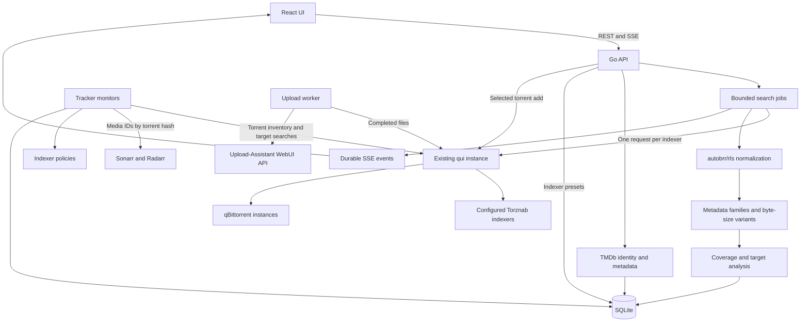

# Architecture

`cmd/server` runs the application. `cmd/mockqui` is an isolated test fixture and is not copied into the production image. Go serves Vite's built assets, so production needs one app container.

`internal/config` validates environment configuration and secret files, and `internal/auth` hashes and verifies the browser password. `internal/qui` implements the upstream HTTP adapter. `internal/arr` reads media identities from Sonarr and Radarr with GET requests only. `internal/metadata` is the TMDb client. `internal/uploads` is the Upload-Assistant client and flag-preset parser. `internal/releases`, `matching`, `clustering`, `ranking` and `policy` implement pure analysis steps: parsing, equivalence, families, ordering and indexer-policy evaluation. `internal/models` holds the shared types. `internal/search` owns bounded jobs, settings, tracker monitors, Sonarr and Radarr identity resolution, upgrades and the upload worker. `internal/database` handles migrations and persistence. `internal/api` exposes routes, validation, browser sessions, bearer auth, request rate limits and generated OpenAPI.

Each job snapshots the connection and selected indexers. Global concurrency bounds indexer HTTP calls, while `MAX_ACTIVE_JOBS` bounds outstanding work. The timeout includes queue time. One indexer failure does not discard successful responses from others. Partial upstream results are preserved, but failed targets cannot produce opportunities.

`internal/metadata` resolves media identities and details through TMDb. Media and season caches persist payloads, raw JSON and expiry timestamps separately. Jobs snapshot resolved media and per-indexer query strategies. The qui adapter chooses supported IDs, including TVDb, before title fallback. Metadata failures return stale details or the entered ID so direct searches can continue.

SQLite uses WAL mode, foreign keys, a busy timeout and one database connection. Embedded numbered migrations are applied transactionally. Raw results, families, family memberships and size variants are committed with the final job record. Progress events are durable and can be replayed by SSE ID. A terminal snapshot closes the stream even after a service restart.

The analysis cache includes the normalized request, selected indexers, target, minimum coverage, connection fingerprint, normalized matching rules and engine version. Each job persists its effective rule snapshot. Cache keys hash connection credentials and do not expose them. Jobs with any failed indexer are not reused. Refresh bypasses both local analysis caching and qui's search cache. The JSON-backed settings and job records read older records without requiring a destructive migration.

The API periodically synchronizes indexers and refreshes stale metadata on demand. It uses `GET /api/torznab/indexers`, `POST /api/torznab/search` and `X-API-Key`. Identifier capabilities use qui's `movie-search-imdbid`, `movie-search-tmdbid`, `tv-search-imdbid` and `tv-search-tmdbid` names. Pagination follows qui's `total` and `offset`. Upstream response bodies and URLs are not included in connection errors or logs.

The adapter contract was checked against [qui's search handler](https://github.com/autobrr/qui/blob/432b5a6eea0cc277a9b1fe5af68261788b84d953/internal/api/handlers/jackett.go) and [search models](https://github.com/autobrr/qui/blob/432b5a6eea0cc277a9b1fe5af68261788b84d953/internal/services/jackett/models.go). It does not embed qui code or hold individual tracker credentials.

Resolution is a URL-backed view preference. Both selectors use the same route state, and changes request only saved families. All resolutions stay in the analysis. Tracker credit factors are nullable; badges use the original field presence to handle older results with zero defaults correctly.

Indexer presets live in a separate SQLite table, so connection and matching updates cannot overwrite them. The UI remembers the last preset ID in local storage, validates its indexers against current availability and reports omitted entries.

The manual torrent action uses `GET /api/instances` and multipart `POST /api/instances/{id}/torrents`. The API accepts a saved result ID and destination options, retrieves the original download URL and indexer ID from SQLite, and forwards them to qui. API responses and events never carry that URL: results report `hasDownloadUrl`, and `raw` is stripped of links and tracker keys. It exposes only destination names and status, defaults to paused, checks the add response, and does not retry. qui handles tracker authentication and torrent fetching.

Unauthenticated startup requires a loopback listener or a declared loopback Docker publication, unless explicitly overridden. Without authentication, requests must address a loopback host name or one in `ALLOWED_HOSTS`, which blocks DNS rebinding. Server middleware protects app routes, assets, documentation and APIs with browser sessions; API clients can authenticate separately with bearer tokens. Login is server-rendered and independent of React. Cookie-authenticated writes require exact origin validation, and logout revokes the session and cancels its requests. Forwarded client addresses and HTTPS scheme headers are accepted only from configured trusted proxies. Public health checks use only SQLite; authenticated readiness checks may contact qui. See [browser login](browser-login.md) and [deployment and data protection](security.md).

Frontend routes and shared layout live in `web/src/app`; search, family details, history and settings pages live in `web/src/features`. Settings editors retain dirty drafts across shared-query updates and accept saved values after their own successful save.

The optional upload worker runs in the same container and persists settings, queue jobs and submission reservations in SQLite. It polls tagged torrents through qui, verifies every file is complete, maps the content path and calls Upload-Assistant's token-authenticated execution API. Target, identity, URL and path snapshots prevent later configuration changes from redirecting queued work. Uncertain submissions require review; the worker never replays them after restart. See [upload workflow](upload-workflow.md).
