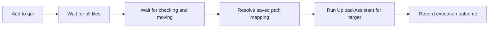

# Upload after download

RavenSeed can add a torrent through qui, wait for the complete download, and invoke the WebUI API in wastaken7's Upload-Assistant fork. The normal Add to qui action remains available.

## Setup

1. Run Upload-Assistant with its WebUI enabled. Configure the target tracker credentials, image hosts and torrent client there.
2. Generate an API token in the Upload-Assistant WebUI.
3. In RavenSeed Settings > Upload-Assistant, enter its reachable WebUI URL and API token. For a service on the Docker host, use `host.docker.internal` instead of `localhost`.
4. Add a target mapping from each qui indexer to its Upload-Assistant tracker code, for example `AITHER`.
5. Add path mappings for each qBittorrent instance. `/downloads` on qBittorrent might map to `/data/downloads` in Upload-Assistant. Both paths must reference the same files; RavenSeed does not copy them. If paths already match, map the path to itself.
6. Test the API connection, enable the upload queue and save.

Credentials entered here stay in the private SQLite volume. The settings API returns only `hasToken`. A blank token retains the saved value. Changing the WebUI URL requires entering a token again. Connection testing reads `/api/browse_roots`; it does not execute an upload or validate tracker credentials.

## Usage

Search with a target indexer, open a release's Add to qui dialog and select a qBittorrent instance. Enable **Upload to target after download**. The dialog shows the mapped tracker and turns off Add paused. Turning Add paused back on leaves the upload waiting until you resume the torrent in qui.

The queue appears under **Upload queue**, with **Active**, **Needs you** and **Done** tabs whose counts cover the whole queue, not just the current page. Closing the browser does not stop processing. Cancel upload is available while waiting and leaves the torrent in qui. Disabling the queue in Settings pauses waiting work but does not terminate an active Upload-Assistant run.

For a failed, needs-review, finished or cancelled job, choose **Reupload**. Select a saved flag preset or edit the flags, then confirm the TMDb ID and submit. This reuses the tagged torrent already in qui and rechecks completion before execution. It does not add or download the torrent again. Check the previous run in UA first because an error or lost connection can happen after a tracker accepted an upload.

Each retry uses a new UA session ID. Previous flags, media identity and outcomes remain under Job details. A retry moves the job's `trackerResult` into that attempt's `previousAttempts[].trackerResult` and clears it, so the job's `trackerResult` always belongs to the current attempt. Active jobs cannot be retried, stale submissions are rejected, and another queue entry cannot take the original entry's upload reservation. Uncertain runs still require an explicit reupload; they are never retried automatically.

New upload jobs use the resolved TMDb identity, including IDs discovered from IMDb searches. UA receives `--tmdb movie/ID` or `--tmdb tv/ID`; IMDb is the fallback when no TMDb ID is available. For older jobs that lack it, enter the ID in the reupload dialog. Leave the field blank to use the saved IMDb fallback.

## Queue behavior

- Each job snapshots its target, media IDs, service URLs, path mappings and selected preset flags. Later settings changes cannot retarget it. A changed service URL pauses waiting work until the original URL is restored or the job is cancelled.
- A unique tag identifies the added torrent; its hash is pinned when first observed. Keep the `ravenseed-...` tag in qui until the job finishes. Ambiguous or missing matches remain waiting.
- Every torrent file must be complete, including files whose download priority was disabled. A complete percentage alone is insufficient.
- Jobs are checked every 30 seconds while Upload-Assistant executions run independently. The default is one execution at a time. Submission starts are spaced at least one minute apart by default, including after a restart; ready jobs show when they are queued. `UA_SUBMISSION_INTERVAL` changes that minimum spacing (at least `1s`). `MAX_CONCURRENT_UPLOADS` accepts 1 through 4. Increase it only if your Upload-Assistant deployment supports simultaneous runs. Runs have a 24-hour limit; a freed worker wakes the queue immediately.
- The worker calls UA only when it is ready to submit; connection testing remains available in Settings. An explicit HTTP 429 keeps the job queued and delays all submissions to that UA URL. RavenSeed honors `Retry-After` when longer than its backoff, starting at one minute and increasing up to one hour on repeated 429 responses. Interrupted streams and connection failures still require manual review because UA may have started the upload.
- Arguments select exactly the mapped tracker with `--trackers`, enable unattended mode, retain duplicate checking by default and skip duplicate prompts. Resolved TMDb or IMDb identity is supplied when available. Named presets can append custom UA flags. RavenSeed supplies the target and media identity; these arguments cannot be overridden by presets. Flags are passed as arguments to UA, never executed through a RavenSeed shell.
- Pending downloads survive restart. Interrupted adds and executions become **Needs review** and are not resubmitted automatically.
- A persistent reservation prevents automatic resubmission of the same torrent hash and target on the same qui instance. Resubmitting the same search result also cannot create duplicate queue jobs. When `HISTORY_RETENTION` deletes a finished job, its reservation stays. Deleting a failed or cancelled job releases its reservation and its link from a tracker-monitor candidate, which can then be queued again, as the job itself could have been reuploaded.
- Upload-Assistant versions that send structured run events report each tracker's result. RavenSeed keeps the target tracker's result on the job as `trackerResult` (`status`, `message`, `link`, `torrentId`) and decides the outcome from it rather than from the exit code:
  - `success` shows **Uploaded**, links the tracker code to the upload and lists the torrent ID under Job details.
  - `dupe`, `skipped` and `banned` fail the job. It shows **Dupe**, **Skipped** or **Banned** in the **Needs you** tab with UA's reason, for example a declined tracker check, and can be reuploaded with different flags.
  - `failed` shows **Failed**, also in **Needs you**, even when UA exited with code zero.
- Without a tracker result, as with older Upload-Assistant versions, **Finished** means Upload-Assistant returned exit code zero. Its WebUI must be checked for the tracker outcome because duplicate skips can also exit successfully. Nonzero exits show **Failed**. Lost streams or uncertain submissions show **Needs review** in either case, keeping a tracker result UA reported before the stream was lost. Check those runs in Upload-Assistant before taking further action.
- Progress follows UA's run stages (preparation, duplicate checks, screenshots, torrent creation, upload). Older UA versions' generic progress events are used until UA sends a known stage. If UA asks a question that unattended mode leaves open, the job says so; when the question closes, the job shows its current stage again. An unanswered question abandons the run after the 30-minute silence limit and the job needs review.
- Raw Upload-Assistant terminal output is not persisted or rendered. RavenSeed shows fixed progress messages and the tracker result only. UA redacts the result's text before sending it; RavenSeed also strips terminal escape codes and limits it to one line of 500 characters. A tracker result should link the torrent's page, so RavenSeed drops a link that is not plain HTTP(S), carries credentials in its user info, has a credential query or fragment parameter, including pairs joined by `&amp;` or `;` and percent-encoded keys such as `pass%6Bey` (keys such as `passkey`, `torrent_pass`, `key`, `apikey`, `authkey`, `auth`, `token`, `secret`, `sig`, `pk` or `rsskey`, matched as whole words of the key, so `monkey` or `author` are kept), has a `download`, `downloads`, `dl` or `rss` path segment or file (such as `download.php`), or holds a 32-character hex run, the usual passkey length, in its path, query or fragment. A 40-character infohash and long title slugs are kept. A kept link is returned HTML-unescaped, so `&amp;` reaches the tracker as `&`.
- Tracker results exist only in UA's live event stream; no UA endpoint returns them after the run. A job interrupted before UA reported the target's result therefore has none, and plain CLI runs of `upload.py` never produce one.

Upload-Assistant must support and be configured for the selected tracker. Its existing preparation, duplicate and tracker checks determine whether an upload proceeds. RavenSeed's discovery result is not proof that a tracker will accept the release.

The adapter follows the fork's [WebUI API](https://github.com/wastaken7/Upload-Assistant/blob/development/docs/web-ui-api.md), [upload arguments](https://github.com/wastaken7/Upload-Assistant/blob/development/docs/cli-args.md) and [execution implementation](https://github.com/wastaken7/Upload-Assistant/blob/development/web_ui/server.py). Tracker catalogue endpoints require a WebUI session rather than the execution API token, so tracker mappings are entered explicitly.

## API

- `GET /api/v1/settings/uploads`: Read settings without the token.
- `PUT /api/v1/settings/uploads`: Save `enabled`, `url`, `token`, `trackers`, `paths`, `flagPresets` and `defaultFlagPresetId`. Use `clearToken` to remove the credential.
- `POST /api/v1/settings/uploads/test`: Validate API access without saving or uploading.
- `POST /api/v1/searches/{id}/results/{resultId}/add`: Set `uploadAfterDownload:true` with the destination options. The target comes from the saved search. Omit `uploadPresetId` to use the default preset, pass an existing preset ID to select it, or use an empty string for no preset. The response includes `uploadJobId`. A result without a usable download link returns `400` and queues nothing; a qui timeout returns `504` and a qui failure `502`, both leaving the job in **Needs review**; a database failure after qui added the torrent returns `500`, so check the queue before retrying.
- `POST /api/v1/monitor-candidates/{candidateId}/upload`: Queue a tracker-monitor candidate from its existing qui torrent. A candidate on a qui instance its monitor no longer scans returns `400`.
- `GET /api/v1/uploads?limit=20&offset=0`: Read queue history. `status=failed,needs_review` limits it to those statuses (`adding`, `downloading`, `uploading`, `needs_review`, `failed`, `finished`, `cancelled`); an unknown status returns `400 invalid_filter`. `statusCounts` gives the number of jobs in every status across the whole queue, whatever the filter.
- `POST /api/v1/uploads/{uploadId}/cancel` with `{}`: Cancel a waiting upload. An unknown job returns `404`.
- `POST /api/v1/uploads/{uploadId}/retry`: Requeue an inactive job with `attempt` set to its current attempt number (zero for older jobs), replacement `args`, and an optional numeric `tmdbId`. Omit `tmdbId` to retain the saved ID or pass zero to clear it. The response is the updated job.

All routes use RavenSeed's normal authentication and origin checks. No tracker is contacted directly by RavenSeed.

## Verification

With the isolated demo running, execute `node scripts/upload-smoke.mjs`; it uses the demo's admin port, 8090. It tests an automatic handoff against mock qui and mock Upload-Assistant. It does not download files or publish a tracker upload. It passes once per demo volume: repeating it with the same demo database intentionally encounters the duplicate reservation for the fixture's fixed torrent hash and fails with `needs_review`. Reset the demo with `down -v` to run it again.

## Torrent defaults and flag presets

Under Settings > Torrent defaults, choose a default qui instance and optionally enable specific categories per instance. With no restriction, all current and future categories are available. An empty enabled list allows only No category. Restrictions also apply to API submissions. An offline or removed default leaves the UI destination unselected.

Under Settings > Upload-Assistant > UA flag presets, add named free-text presets such as `--anon --modq`. Set an optional default and choose a different preset, or No preset, in the add dialog. Quote values with spaces. The selected name and flags are saved on the upload job and remain unchanged after preset edits or deletion. The UA version and tracker determine which flags are supported. Flags may change UA behavior, including duplicate checking.
